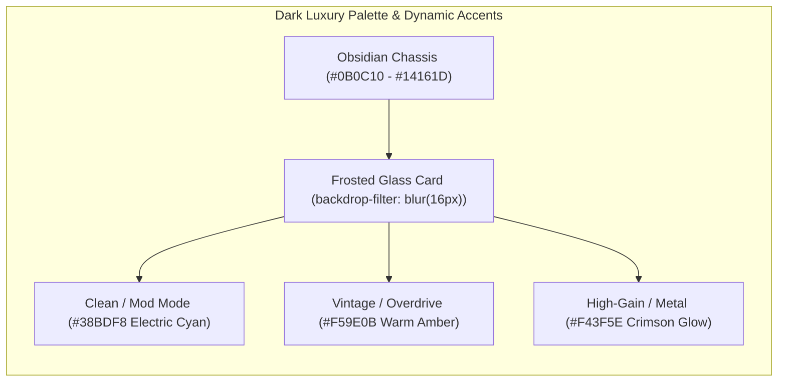

# Hack-Effect — Premium World-Class UX/UI Blueprint (Neural DSP Archetype / Quad Cortex Style)

> **Design Goal:** ยกระดับ UX/UI สู่ระดับปลั๊กอินและฮาร์ดแวร์ระดับโลก (Neural DSP Archetype / Quad Cortex) ที่ทำงานลื่นไหล 60fps เชื่อมต่อโดยตรงกับท่อ `LoopbackWsServer` ของ C++ Engine (`ws://127.0.0.1:8765/ws?token=...`) โดยใช้ค่าคู่ขนาน `normalized` (`0.0..1.0`) + `value`/`unit`

---

## 1. Visual Theme & Material System (Dark Luxury & Glassmorphism)



### CSS Design Tokens สำหรับ Premium Dark UI
```css
:root {
  /* Obsidian & Matte Charcoal Surfaces */
  --surface-obsidian: #0B0C10;
  --surface-charcoal: #101218;
  --surface-card: rgba(20, 22, 29, 0.76);
  --surface-elevated: rgba(29, 34, 44, 0.88);

  /* Glassmorphism & Hairline Borders */
  --glass-blur: blur(16px) saturate(140%);
  --border-subtle: rgba(255, 255, 255, 0.07);
  --border-glow: rgba(245, 158, 11, 0.38);

  /* Dynamic Amp Character Accents (switched via data-voicing="clean|vintage|highgain") */
  --accent-amber: #F59E0B;
  --accent-cyan: #38BDF8;
  --accent-crimson: #F43F5E;
  --accent-active: var(--accent-amber);
}
```

---

## 2. Hardware-Grade Micro-Interactions (Rotary Knobs & Controls)

1. **SVG + LED Arc Ring (`normalized` Driven):**
   - รับค่า `normalized` (`0.0` ถึง `1.0`) จาก C++ IPC มาคำนวณมุมเข็มและวงแหวนไฟ LED รอบลูกบิดโดยตรง:
     $$\theta(\text{deg}) = -135^\circ + 270^\circ \times \text{normalized}$$
   - แสดงตัวเลขดิจิทัลใต้ปุ่มหมุนจาก `display_value` + `unit` (`dB`, `Hz`, `ms`, `%`, `st`) ทันทีโดยที่ฝั่ง UI ไม่ต้องเขียนสูตรแปลง logarithmic/linear เอง
2. **Pro Gesture Controls:**
   - **Vertical Drag:** ลากเมาส์ขึ้น-ลง (`160px` full sweep)
   - **Fine-Tune Mode (`Shift` + Drag / Mouse Wheel):** ปรับความละเอียดเพิ่ม `10x` (`0.1 dB` / `1 Hz`)
   - **Double-Click Reset:** รีเซ็ตกลับค่า `default` ของพารามิเตอร์นั้นทันที

---

## 3. 60fps Real-Time Visualizers & Telemetry HUD

- **Input / Output Stereo Ballistic VU Meters:**
  - อ่านค่า `meters.input_dbfs` และ `meters.output_dbfs` จาก WebSocket 60fps วาดบน `<canvas>` พร้อม Peak-Hold indicator ค้าง 1.5 วินาที และไฟเตือน Clip สีแดงเมื่อแตะ `-0.1 dBFS`
- **Interactive EQ Curve & IR Spectrum Analyzer:**
  - แสดงเส้น Frequency Response (`20 Hz` – `20 kHz` บนสเกลลอการิทึม) ที่ขยับตามการลากจุด (Draggable EQ Nodes)
- **Quad Cortex Style Top-Right Health Pill:**
  - แสดงสถานะ `SR 48kHz · 128 smp (2.67 ms)` | `DSP p99: 0.002 ms` | `XRUN: 0` พร้อมไฟสถานะสีเขียว/เหลือง/แดงตาม `gate_check.passed`

---

## 4. Interactive Signal Chain Bar & 8-Scene Footswitch Dock (A–H)

1. **Top Signal Chain Bar:**
   - แสดงไอคอนแต่ละบล็อก (`GATE` → `PITCH` → `DRIVE` → `AMP/NAM` → `EQ` → `CAB` → `MOD` → `DELAY` → `REVERB`)
   - คลิกซ้ายเพื่อเลือกแผงควบคุม คลิกปุ่ม LED บนไทล์เพื่อ Toggle Bypass แบบไร้เสียงคลิก (Zero-Click Smoothed Bypass ใน C++)
2. **Bottom 8-Scene Footswitch Bar (`Scene A` – `Scene H`):**
   - สลับโทนเสียงทั้งยวงผ่านคำสั่ง `{"type": "set_scene", "scene_index": 0..7}` โดยไม่โหลดโมเดลหรือจองหน่วยความจำใหม่ (Gapless Switching)
   - รองรับคีย์ลัดแป้นพิมพ์ `1`–`8` หรือ `A`–`H` และโหมดเต็มจอ **Gig View** สำหรับใช้งานบนเวที
